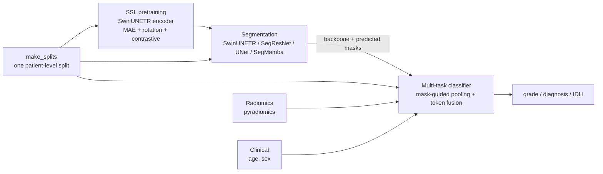

# glioma-mtl

Self-supervised pretraining, tumour segmentation and multi-task **grade / WHO-2021 diagnosis / IDH**
classification of diffuse gliomas on pre-operative MRI from the
[UCSF-PDGM](https://www.cancerimagingarchive.net/collection/ucsf-pdgm/) dataset, built with
[MONAI](https://monai.io/) and PyTorch.

> Code for the diploma thesis *&lt;title&gt;* (&lt;author&gt;, University of Nicosia). The original
> exploratory notebooks are kept in [`notebooks/archive/`](notebooks/archive/); this package is the
> cleaned-up, reproducible version of that work.



## Repository layout

```
configs/            YAML experiment configs (inherit from base.yaml, override with --set key=value)
data/
  splits/           the shared patient-level split (IDs only, safe to commit)
  metadata/         put the UCSF-PDGM metadata CSVs here (git-ignored)
notebooks/archive/  original thesis notebooks, outputs stripped
scripts/            command-line entry points (one per pipeline stage)
src/glioma_mtl/
  data/             metadata + leakage guard, splits, file discovery, MONAI transforms, loaders
  models/           SwinUNETR feature extraction, SSL pretrainer, segmentation factory, MultiTaskGliomaNet
  engine/           training loops (SSL, segmentation, classification)
  evaluation/       per-case metrics, bootstrap CIs, paired Wilcoxon tests
  losses.py         SSL losses, focal / CE, SupCon, multi-task loss
  radiomics.py      pyradiomics extraction + train-only feature selection
  experiment.py     config -> data/model wiring used by the scripts
tests/              CPU unit tests (pytest)
```

## Installation

```bash
python -m venv .venv
```

```bash
source .venv/bin/activate          # Windows: .venv\Scripts\activate
```

Install PyTorch for your CUDA version first (https://pytorch.org/get-started/locally/), then:

```bash
pip install -e ".[radiomics,boosting,dev]"
```

SegMamba is optional and needs a CUDA build of https://github.com/ge-xing/SegMamba (see
`configs/seg_segmamba.yaml`).

## Data

See [`data/README.md`](data/README.md). In short: download UCSF-PDGM from TCIA, point
`data.image_dir` (and optionally `data.label_dir`) at it, and copy the metadata CSV and the
classification-cohort CSV into `data/metadata/`. Images and masks are matched **by patient ID**, so both
the official nested layout and flat folders work.

## Reproducing the paper

The whole experiment set is one resumable command (or the Colab notebook
[`notebooks/colab_paper_runs.ipynb`](notebooks/colab_paper_runs.ipynb)); see
[`docs/paper_protocol.md`](docs/paper_protocol.md) for the experiment matrix, compute budget and
reporting checklist.

```bash
python scripts/run_paper.py --plan configs/paper.yaml --dry-run
```

```bash
python scripts/run_paper.py --plan configs/paper.yaml
```

Tables are written to `runs/paper/paper_tables/` (CSV, Markdown, LaTeX) and figures to
`runs/paper/paper_figures/`. Explanations (fusion attention, token occlusion, 3D Grad-CAM) are in each
classifier's `explain/` folder, and XGBoost TreeSHAP is in `kfold_cv/holdout_shap.csv`.

## Usage

Every script takes `--config` plus optional `--set key=value` overrides. Outputs (config copy, log,
`history.csv`, checkpoints, predictions) go to `runs/<name>/`.

**1. One split for everything.** Classification test patients are also segmentation test patients and
are never used for SSL or segmentation training.

```bash
python scripts/make_splits.py --config configs/base.yaml
```

**2. SSL pretraining** (optional):

```bash
python scripts/pretrain_ssl.py --config configs/ssl.yaml
```

**3. Segmentation.** Use the same budget for every model, and several seeds if you can:

```bash
python scripts/train_segmentation.py --config configs/seg_swin_unetr_ssl.yaml
```

```bash
python scripts/train_segmentation.py --config configs/seg_segresnet.yaml --set seed=1 name=seg_segresnet_s1
```

```bash
python scripts/evaluate_segmentation.py --config configs/seg_segresnet.yaml --checkpoint runs/seg_segresnet/best.pt
```

```bash
python scripts/compare_models.py runs/seg_segresnet/per_case_segmentation_test.csv runs/seg_swin_unetr_ssl/per_case_segmentation_test.csv
```

**4. Predicted masks** for test-time localisation of the classification crops:

```bash
python scripts/evaluate_segmentation.py --config configs/seg_swin_unetr_ssl.yaml --checkpoint runs/seg_swin_unetr_ssl/best.pt --stage classification --split test --save-predictions data/predictions/swin
```

(and the same with `--split val`)

**5. Baselines without images.** Run these first, so you know what the imaging model has to beat:

```bash
python scripts/kfold_cv.py --config configs/kfold_cv.yaml
```

**6. Classification:**

```bash
python scripts/train_classifier.py --config configs/cls_mask_guided.yaml --set data.crop_mask_key=pred_mask data.pred_mask_dir=data/predictions/swin
```

```bash
python scripts/evaluate_classifier.py --config runs/cls_mask_guided/config.yaml --checkpoint runs/cls_mask_guided/best.pt
```

The paper's main comparison is a ladder of the same model with growing inputs: `cls_image_only.yaml` →
`cls_mask_guided.yaml` (image + clinical: age, sex, biopsy before MRI) → `cls_image_clinical_radiomics.yaml`.
`cls_leaky_reference.yaml` and `cls_leaky_reference_radiomics.yaml` repeat the last two rungs with the
thesis clinical vector, which includes post-operative molecular variables; they are references only. The thesis
architectures are `cls_cascade`, `cls_multiscale`, `cls_trinity` and `cls_segmamba`.
`cls_idh_radiogenomics.yaml` predicts IDH from imaging, and `cls_thesis_reproduction.yaml` reproduces the
thesis setting, leakage included, for comparison only.

**Radiomics** (optional token / tabular baseline):

```bash
python scripts/extract_radiomics.py --config configs/cls_mask_guided.yaml
```

then add `--set radiomics.csv=runs/radiomics/radiomics_label.csv` to the training or k-fold command.

**Late fusion with k-fold CV (XGBoost).** Label-free deep features from the segmentation backbone
(pooled inside the predicted tumour, never trained with class labels) + demographics + radiomics, with
repeated stratified 5-fold CV and an optional one-shot hold-out test:

```bash
python scripts/extract_deep_features.py --config configs/cls_mask_guided.yaml --checkpoint runs/seg_swin_unetr_ssl/best.pt --mask-source pred --pred-dir data/predictions/swin
```

```bash
python scripts/kfold_cv.py --config configs/kfold_cv.yaml --holdout --set deep_features.csv=runs/deep_features/deep_features_pred.csv
```

## Methodological safeguards

These are built into the code because the thesis notebooks ran into each of them:

| Problem | Safeguard |
|---|---|
| IDH / 1p19q *define* the WHO-2021 diagnosis; EOR is post-surgical | `clinical.groups` defaults to `[demographics]`; `check_leakage()` refuses `molecular` / `surgical` unless `allow_leakage: true` |
| Different, overlapping splits per stage | one JSON split, validated on load (`validate_splits`) |
| Preprocessing / feature selection fit on all patients | `ClinicalFeaturizer`, `RadiomicsFeaturizer` and the sklearn pipelines are fit on training data only |
| Images and masks paired by sorted file order | pairing by patient ID; follow-up scans (`*_FU###d`) are excluded |
| `strict=False` checkpoint loads that silently load nothing | `load_weights()` raises if < 90% of the parameters match |
| Hooks + hard-coded channel counts producing all-zero tokens | explicit `swin_unetr_forward()`, channel counts derived from `feature_size`, shape checks raise |
| Test metrics computed on the wrong loader | `evaluate_*` scripts take an explicit `--split` and log its size |
| Half of the classification crops were background; eval used a fixed centre crop | tumour-centred crops (`pos=1, neg=0`) and `CropAroundMaskd` (GT = oracle, or predicted masks) |
| Fixed [0, 3000] intensity window on raw MRI | per-volume z-score (`intensity.kind: zscore`; `range` reproduces the thesis) |
| Voxel-wise SSL masking; validation in train mode | cube masking (`mask_patch_size`), eval-mode validation with a fixed seed |
| Single numbers on 25 test patients | bootstrap 95% CIs, per-case CSVs, paired Wilcoxon, repeated CV for tabular models |
| XGBoost trained on embeddings from a network fit to the same patients' labels | k-fold CV on label-free segmentation-backbone features, selection inside each fold |

### Mapping thesis model variants to `MultiTaskGliomaNet`

| Thesis notebook variant | Config |
|---|---|
| Cascade (frozen encoder + clinical MLP) | `fusion: concat`, `mask_mode: none`, `freeze_backbone: true` |
| Image only | `clinical.groups: []` |
| Transformer fusion | `fusion: transformer`, `mask_mode: none` |
| Mask-guided MTL | `mask_mode: hard`, `encoder_stages: [4]`, `use_decoder_token: true` |
| Multi-scale | `encoder_stages: [2, 3, 4]` |
| Soft masking (V3) | `mask_mode: soft` |
| Trinity (cross-attention) | `fusion: cross_attention`, `encoder_stages: [1, 2, 3]` |

## Baselines without imaging

On the 162-patient classification cohort, logistic regression with 5-fold × 10-repeat stratified CV
(`scripts/kfold_cv.py`, all preprocessing inside the folds):

| Inputs | Grade acc / AUC | Diagnosis acc / AUC | IDH acc / AUC |
|---|---|---|---|
| Majority class | 0.39 / 0.50 | 0.42 / 0.50 | 0.49 / 0.50 |
| Age + Sex | 0.53 / 0.66 | 0.51 / 0.71 | 0.84 / 0.90 |
| Thesis clinical vector *(leaky reference: contains IDH, 1p/19q, MGMT, EOR)* | 0.65 / 0.78 | 0.82 / 0.95 | — |

An imaging model is only informative if it clearly beats the **Age + Sex** row (for IDH that row is
already at 0.84).

## Tests

```bash
pytest
```

The tests run on CPU with small inputs (about 2 minutes). They check, among other things, that the
explicit SwinUNETR forward matches MONAI's output, that every image token receives a gradient in all
fusion modes, the split invariants, the leakage guard, and train-only preprocessing.

## Data citation

If you use UCSF-PDGM, cite: Calabrese E., Villanueva-Meyer J. E., Rudie J. D., *et al.* "The University of
California San Francisco Preoperative Diffuse Glioma MRI Dataset." *Radiology: Artificial Intelligence*
4(6), 2022. https://doi.org/10.1148/ryai.220058
